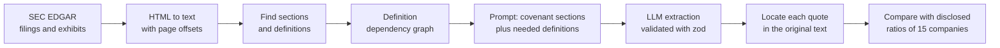

# Covenant Compass

[](https://github.com/subinsk/covenant-compass/actions/workflows/ci.yml)

Covenant monitoring for private credit lenders. Covenant Compass reads credit agreements filed with SEC EDGAR, extracts the financial maintenance covenants (leverage, coverage and similar ratio tests) with a citation for each one that is checked against the agreement text, and tracks compliance obligations per facility in a web app for lenders and borrowers.

## How it works

Extraction is a pipeline of small, mostly deterministic steps. Only one step calls an LLM, and its output is checked against the source text.



1. **Fetch** (`lib/edgar`): find credit agreement exhibits (EX-10) in a company's filings, through a rate-limited, disk-cached EDGAR client.
2. **Text** (`lib/agreements/text.ts`): convert the exhibit HTML to plain text deterministically, dropping struck-through text and page numbers and recording where each page starts, so character offsets can be cited with a page number.
3. **Structure** (`lib/agreements/sections.ts`, `clauses.ts`): find the definitions article and the financial covenant sections, every defined term, and the sentences and enumerated clauses, all as offsets into the same text.
4. **Definition graph** (`lib/agreements/graph.ts`): record which defined terms each definition mentions, so a covenant can be traced from "Leverage Ratio" to "Consolidated EBITDA" and further.
5. **Extract** (`lib/extraction`): send the covenant sections plus the definitions they depend on (up to four levels) to an LLM, validate the JSON reply with zod and retry on failure, then find each returned quote in the original text. A covenant whose quote can't be found is marked unverified.
6. **Evaluate** (`data/eval/companies.json`): compare the result with the covenant limits and actual ratios that 15 companies disclosed in their 10-Q filings.

More detail is in [docs/ARCHITECTURE.md](docs/ARCHITECTURE.md).

## Stack

- Next.js 16 (App Router), React 19, Tailwind CSS 4
- TypeScript, zod
- PostgreSQL with Prisma 5
- JWT sessions (`jose`) in an HTTP-only cookie, bcrypt password hashes
- Any OpenAI-compatible chat completions endpoint for the LLM (for example a local Ollama server or Groq)
- Vitest and ESLint; GitHub Actions for CI

## Getting started

### Prerequisites

- Node.js 22 (the version CI uses)
- PostgreSQL
- For the extraction scripts: an OpenAI-compatible LLM endpoint, such as [Ollama](https://ollama.com) running locally

### Setup

```bash
cp .env.example .env      # then fill in the values below
npm ci
npx prisma db push        # create the tables from prisma/schema.prisma
npx prisma db seed        # demo lender, borrowers, facilities and covenants
npm run dev               # http://localhost:4000
```

The repo has no migration history yet, so `prisma db push` creates the schema. The seed deletes existing facilities, covenants, users and organizations before inserting demo data.

### Environment variables

| Variable | Purpose |
| --- | --- |
| `DATABASE_URL` | PostgreSQL connection string. |
| `JWT_SECRET` | Signs session tokens. Required in production; development falls back to a fixed dev secret. |
| `CRON_SECRET` | Bearer token required by `/api/system/cron`, the daily compliance status job. With no secret set, the route rejects every request. |
| `LLM_BASE_URL` | Base URL of an OpenAI-compatible API, e.g. `http://localhost:11434/v1/` for Ollama or `https://api.groq.com/openai/v1` for Groq. |
| `LLM_API_KEY` | API key for that endpoint. Ollama ignores it, but it must be non-empty. |
| `LLM_MODEL` | Model name, e.g. `qwen3:4b` on Ollama or `openai/gpt-oss-20b` on Groq. |
| `LLM_TIMEOUT_MS` | Optional request timeout. Raise it for slow local models; Node's fetch otherwise gives up after 5 minutes. |
| `LLM_REASONING_EFFORT` | Optional `low`, `medium` or `high`; sent only when set. |
| `LLM_CACHE` | Optional; `1` caches LLM responses on disk in `.cache/llm` (or `LLM_CACHE_DIR`). For development. |
| `SEC_USER_AGENT` | Required by SEC for EDGAR requests: a name and contact email, e.g. `Covenant Compass you@example.com`. |
| `EDGAR_CACHE_DIR` | Optional EDGAR response cache directory (default `.cache/edgar`). |

### Running a local model with Ollama

Ollama's default context window is 4,096 tokens and it silently drops the start of longer prompts, which removes the instructions and covenant text. Extraction prompts are up to about 15,000 tokens, so start Ollama with a larger window:

```
OLLAMA_CONTEXT_LENGTH=16384 ollama serve
```

On a laptop CPU, a 4B model reads prompts at roughly 20 tokens/second, so one agreement takes several minutes. Set `LLM_TIMEOUT_MS` accordingly, or use a hosted endpoint for full eval runs.

### Demo login

The seed creates these users, all with the password `secret`:

- `alice@acmecapital.com` (lender admin)
- `user0@acmecapital.com` to `user4@acmecapital.com` (lender users)
- `bob@globex.com` (borrower user for Globex; sees only Globex's obligations in the borrower portal at `/portal`)

### Scripts

| Command | What it does |
| --- | --- |
| `npm run dev` | Start the dev server on port 4000. |
| `npm run build` / `npm start` | Production build and server. |
| `npm run lint` | ESLint. |
| `npm run typecheck` | `tsc --noEmit`. |
| `npm test` | Run the Vitest suite once. |
| `npm run edgar:exhibits -- <cik>` | List EX-10 exhibits in a company's recent 8-K, 10-K and 10-Q filings. |
| `npm run agreement:text -- <exhibit-url>` | Print an exhibit's length and page count and the start of its text. |
| `npm run agreement:sections -- [exhibit-url ...]` | Show the sections and definitions found (all eval agreements when no URL is given). |
| `npm run agreement:clauses -- [TICKER ...]` | Split eval companies' covenant sections into sentences and print samples. |
| `npm run definitions:graph -- <exhibit-url> [term] [depth]` | Print the definitions a term is built from and any circular definitions. |
| `npm run extract:covenants -- <ticker>` | Run LLM extraction on an eval company's agreements and print the result next to the expected limits. |
| `npm run extract:facility -- <facilityId> <exhibit-url>` | Run LLM extraction on an agreement and save the covenants found to the facility as a run waiting for review. |

The EDGAR scripts need `SEC_USER_AGENT`; `extract:covenants` and `extract:facility` also need the `LLM_*` variables.

## MCP server

`npm run mcp` starts a stdio [Model Context Protocol](https://modelcontextprotocol.io) server, so any MCP client can use the covenant tools:

| Tool | What it does |
| --- | --- |
| `list_eval_companies` | Eval-set companies with covenant limits, disclosed actual ratios and agreement URLs. |
| `find_covenant_sections` | Financial covenant sections of an EDGAR agreement (heading, page, first 800 characters). |
| `search_agreement` | Case-insensitive phrase search over an agreement; matching sentences with page numbers. |
| `test_covenant` | Evaluate a JSON formula against inputs: value with trace, missing inputs, compliance, headroom and the denominator cushion for maximum ratios. |
| `extract_covenants` | LLM extraction of an agreement's financial covenants (needs the `LLM_*` variables). |

Client config (run from the repo root; the server also reads `.env` from its working directory):

```json
{
  "mcpServers": {
    "covenant-compass": {
      "command": "npx",
      "args": ["tsx", "mcp/server.ts"],
      "cwd": "/path/to/covenant-compass",
      "env": {
        "SEC_USER_AGENT": "Covenant Compass you@example.com",
        "LLM_BASE_URL": "http://localhost:11434/v1/",
        "LLM_MODEL": "qwen3:4b",
        "LLM_API_KEY": "ollama"
      }
    }
  }
}
```

The `LLM_*` entries are optional; without them every tool except `extract_covenants` works.

## Testing

```bash
npm test            # unit tests (Vitest)
npm run lint
npm run typecheck
```

Tests cover the parts where mistakes are costly: HTML-to-text conversion and page offsets, section, definition and clause finding, the definition graph, quote location, the LLM client's JSON validation and retry, the EDGAR client's caching and retries, the eval set's schema, and the auth checks (JWT, passwords, cron secret). Tests use small fixtures and mocked `fetch`; they don't call EDGAR or an LLM.

Integration tests (`*.int.test.ts`) run against a real Postgres and check that one organization can't read another's facilities, covenants, occurrences or organizations through the API routes and query scopes. `npm test` skips them. To run them, create an empty database whose name ends in `_test` and point `DATABASE_URL_TEST` at it: `DATABASE_URL_TEST=postgresql://postgres@localhost:5432/covenant_compass_test npm run test:int`. The schema is reset with `prisma db push --force-reset` at the start of every run. CI runs them against a Postgres service container.

GitHub Actions runs `npm ci`, `prisma generate`, lint, typecheck and tests on every pull request and on pushes to `main` ([.github/workflows/ci.yml](.github/workflows/ci.yml)).

## Evaluation set

[`data/eval/companies.json`](data/eval/companies.json) lists 15 US public companies whose credit agreements contain financial maintenance covenants and whose 10-Q filings disclose the covenant limit and the actual ratio for the period. For each company it records the ticker, CIK, period end, each covenant's name, operator, limit and disclosed actual value, a link to the 10-Q, and links to the credit agreement and amendment exhibits on EDGAR.

The disclosed figures are the ground truth: the extracted limit can be compared with the limit the company reported, and a computed ratio with the actual ratio it reported. The set includes one disclosed breach (TTEC's net leverage ratio of 3.85x against a 3.75x maximum, later waived) and a stress case with forbearances and amendments (Compass Diversified). A `covenantEbitdaReconciliation` flag marks the four companies that publish a reconciliation of covenant EBITDA.

The file is validated with zod when loaded (`lib/eval/companies.ts`).

## Limitations

- Extraction runs from the command line; extracted covenants are not yet saved to the database or shown in the web app. Covenants in the app are entered by hand or come from the seed.
- Extraction accuracy has not been measured on a real model. `extract:covenants` prints results next to the expected limits for inspection, but there is no scoring run yet.
- Covenant ratios use "Consolidated EBITDA" as defined in each agreement, with add-backs that don't appear in XBRL financial data. A ratio computed from reported figures will differ from the covenant ratio.
- Exhibits filed as scanned images have little or no usable text. Section finding has a fallback for exhibits whose text arrives without line breaks, but text inside images is not read (no OCR).
- Section and definition finding are heuristics tuned on the eval agreements; unusual layouts can be missed.
- The covenant suggestion endpoint (`/api/ai/parse-covenant`) uses keyword rules, not the LLM.
